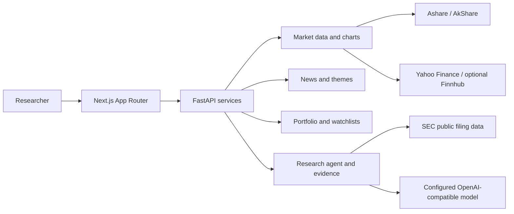

# OpenAshare

<p align="center">
  <a href="README.md"><strong>English</strong></a> · <a href="README.zh-CN.md">简体中文</a>
</p>

<p align="center">
  <strong>A multilingual research desk for US, mainland China, and Hong Kong equities.</strong><br />
  Connect prices, news, filings, charts, and portfolio context in one research workflow.
</p>

<p align="center">
  <a href="https://github.com/ZhiweiChen-coder/OpenAshare/stargazers"></a>
  <a href="https://nextjs.org/"></a>
  <a href="https://fastapi.tiangolo.com/"></a>
  <a href="https://www.python.org/"></a>
  <a href="LICENSE"></a>
</p>

OpenAshare brings stock research into one workspace. Follow a company, review its price history and news, inspect available filings and market context, and ask an AI research agent follow-up questions with the research context retained.

English is the default interface language, and US equities are the default market. Simplified Chinese is available from the language switcher. Change the workspace market to mainland China or Hong Kong in settings.

> **Research use only.** OpenAshare does not provide investment advice or place trades. Market data may be delayed, incomplete, or unavailable depending on the instrument and provider. Verify important facts against the original source.

## Markets and data coverage

| Market | Example symbols | Current workflow |
| --- | --- | --- |
| United States | `AAPL`, `US.AAPL`, `US.BRK.B` | Historical prices and charts; SEC filing metadata and selected standardized financial facts for verified issuers; news coverage depends on configured providers. |
| Mainland China | `sh600036`, `sz000001` | A-share search and daily price history through the existing Ashare / AkShare data paths, with China-focused news and market themes. |
| Hong Kong | `00700.HK` | Hong Kong equity price history and charts, plus Hang Seng market context. Company news and other research data depend on provider coverage. |

US prices use Yahoo Finance with an optional Finnhub fallback. Hong Kong symbols are normalized inside the app and mapped to Yahoo Finance's exchange symbol format. Mainland China data uses the existing Ashare and AkShare integrations. Provider availability, exchange holidays, symbol formats, rate limits, and source terms can affect results.

Coverage is not identical across markets. SEC tools apply to SEC-verified US issuers; they do not provide equivalent filing coverage for mainland China or Hong Kong companies. The market overview currently uses ETF proxies for major US indices, four mainland indices, and the Hang Seng Index for Hong Kong. It is a research view, not a complete market scanner or a real-time exchange feed.

## What you can do

- Search supported companies and symbols across the three markets.
- Review historical price charts, technical indicators, and market context.
- Follow company news and market themes where configured sources provide coverage.
- Ask focused research questions and inspect retrieved sources, dates, and data gaps.
- Compare selected SEC-reported financial facts for verified US issuers.
- Track holdings, watchlists, portfolio observations, and research conversations.
- Save reports and sources from the research workspace.

The agent assists with research; it does not execute orders. For details on US company research and its evidence limits, see [US research notes](docs/pydantic-us-research.md).

## Landing page demos

The landing page includes three recorded research workflows:

- **Company news:** look up recent NVIDIA headlines. [Watch the demo](public/marketing/demo-stock-questions.mp4).
- **Chart research:** select a period on Micron's chart and ask about the move. [Watch the demo](public/marketing/demo-chart-research.mp4).
- **Deep research:** investigate a biotech theme and follow the evidence into related companies. [Watch the demo](public/marketing/demo-deep-research.mp4).

The landing page serves H.264 MP4s and matching poster images from `public/marketing/`. Raw MOV source recordings are local files and are excluded from Git and deployment uploads.

## Star History

<a href="https://www.star-history.com/?repos=ZhiweiChen-coder%2FOpenAshare&type=date&legend=top-left">
  <picture>
    <source media="(prefers-color-scheme: dark)" srcset="https://api.star-history.com/chart?repos=ZhiweiChen-coder/OpenAshare&type=date&theme=dark&legend=top-left" />
    <source media="(prefers-color-scheme: light)" srcset="https://api.star-history.com/chart?repos=ZhiweiChen-coder/OpenAshare&type=date&legend=top-left" />
    
  </picture>
</a>

## Architecture



## Technology

- **Frontend:** Next.js App Router, React, TypeScript, and `lightweight-charts`
- **Backend:** FastAPI, Pydantic, and server-sent event progress updates
- **Research:** PydanticAI, public SEC data, provider-backed news and market search
- **Storage:** SQLite and local browser settings; optional Supabase workspace integration
- **Markets:** Ashare / AkShare, Yahoo Finance, and optional Finnhub

## Run locally

### Requirements

- Python 3.12 or later
- Node.js 20–22
- npm

### 1. Install dependencies

```bash
python3 -m venv .venv
source .venv/bin/activate
pip install -r requirements_api.txt
npm install
```

The full `requirements.txt` includes additional legacy analysis dependencies. Install it only if you need those modules:

```bash
pip install -r requirements.txt
```

### 2. Configure optional services

Create an ignored `.env` file in the project root. The app can run without an AI model, but agent features may be limited to the available deterministic research paths.

```env
LLM_API_KEY=your_api_key
LLM_BASE_URL=https://api.deepseek.com
LLM_MODEL=your_model_name

# Required for SEC company research; use an application name and contact email.
SEC_USER_AGENT=OpenAshare research contact@example.com

# Optional US news and quote fallback.
FINNHUB_API_KEY=

# Optional online stock-search autocomplete.
EASTMONEY_TOKEN=
```

For optional cloud authentication and workspace persistence, configure the Supabase variables documented in `.env.docker.example`. Keep secret and service-role keys on the server; never commit credentials.

### 3. Start the API and web app

In separate terminals:

```bash
./scripts/run_api.sh      # http://127.0.0.1:8000
npm run dev               # http://127.0.0.1:3000
```

If the API uses a different port, set `NEXT_PUBLIC_API_BASE_URL` in `.env.local` and restart Next.js:

```env
NEXT_PUBLIC_API_BASE_URL=http://127.0.0.1:8001
```

```bash
API_PORT=8001 ./scripts/run_api.sh
npm run dev -- -p 3001
```

## Main routes

- `/` — redirects to the English landing page by default; a saved language choice is respected
- `/landing` — product overview and research journal
- `/journal/biotech-headline` and `/journal/ai-chip-cycle` — standalone research articles
- `/work` — research workspace and agent
- `/stocks` and `/charts` — stock search, analysis, and charts
- `/news` and `/hotspots` — news and market themes
- `/portfolio` — holdings and portfolio research
- `/settings` — language, default market, research depth, and workspace settings

Use `?lang=zh` or the language switcher to view the interface in Simplified Chinese. New research reports follow the selected language; saved reports keep their original wording.

## Project structure

```text
.
├── api/          # FastAPI routes, schemas, research services, and SSE
├── app/          # Next.js App Router pages
├── components/   # Frontend interface and workspace components
├── lib/          # API client, shared types, localization, and utilities
├── ashare/       # Market data, analysis, search, and monitoring
├── scripts/      # Local run and research scripts
├── tests/        # Backend and frontend behavior tests
└── assets/       # Product screenshots and media
```

## Validation

```bash
python -m pytest tests/test_api_app.py -q
npm run build
```

## Contributing

Issues, discussions, and pull requests are welcome. Keep changes focused, update `api/schemas.py` and `lib/types.ts` together when API contracts change, and never commit API keys or machine-specific configuration.

## License

[MIT](LICENSE)
